# 🍟 Grand Theft Poutine

**A GTA-like open-world game set in a real, recognizable downtown Montréal — generated from actual map data.**

No missions (yet). The game *is* the city: real street grid, real street names, real landmarks, Mont Royal at real elevation. Walk it, drive it, watch the sun set over the Old Port.

*Working title: MTL — Open Île.*

| | |
|---|---|
| 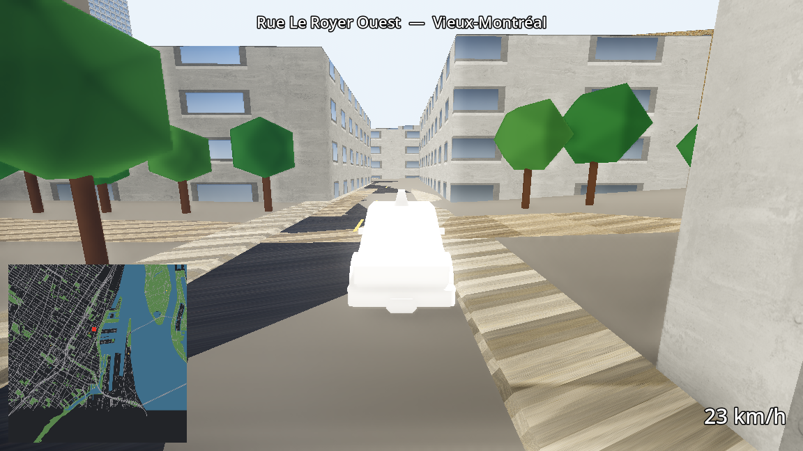 | 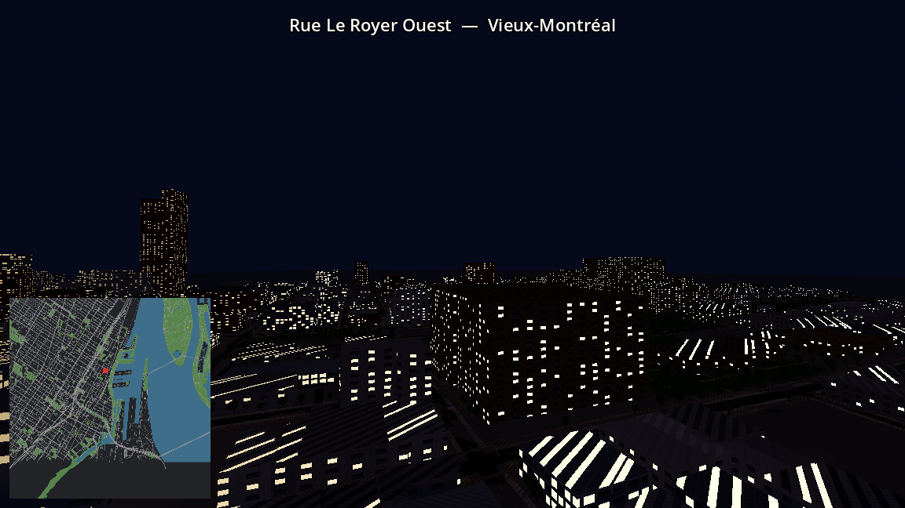 |
| 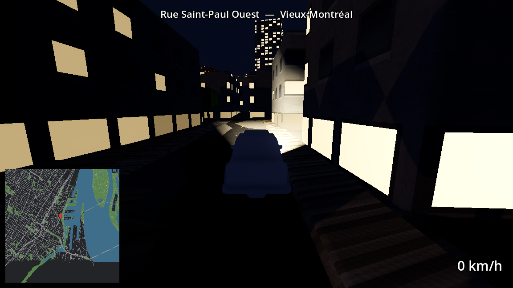 | 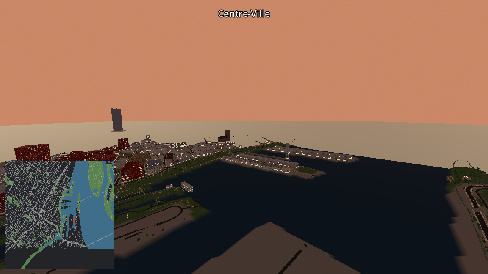 |
| 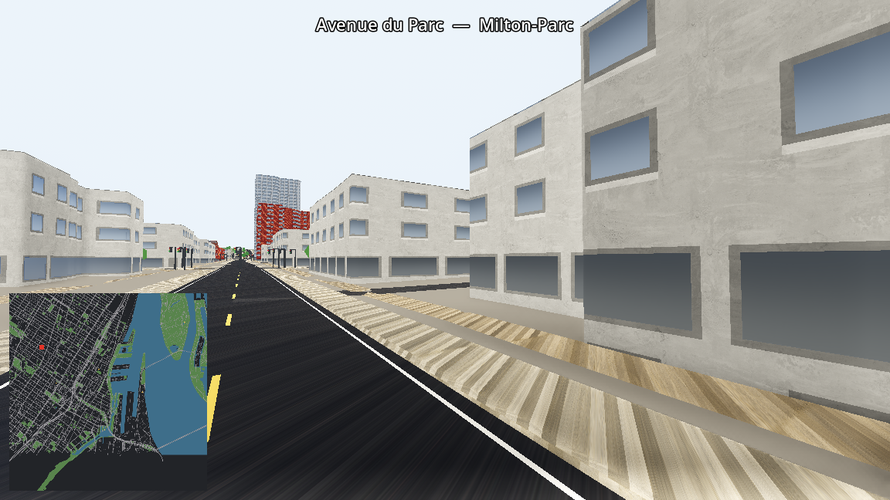 | 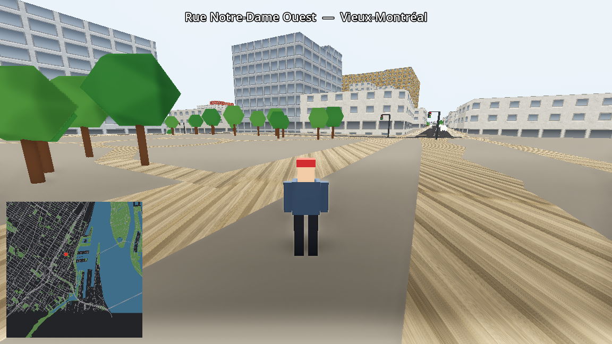 |
| 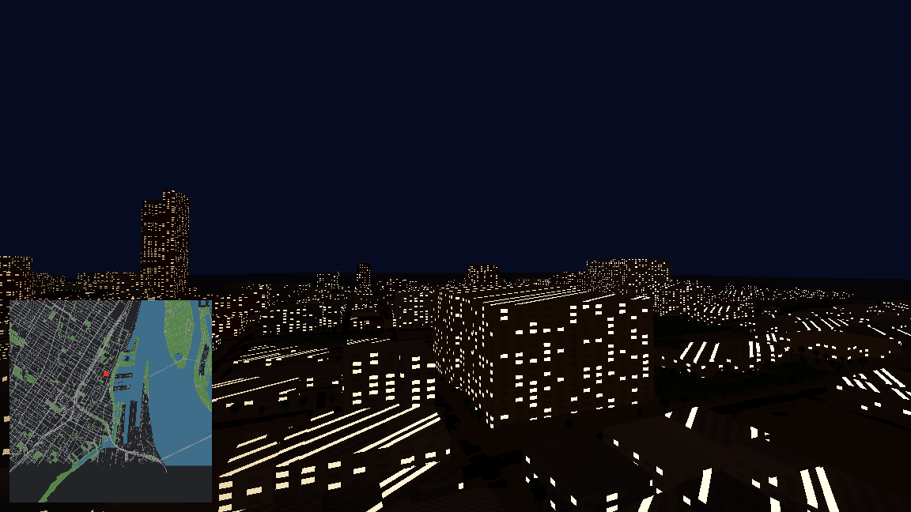 | 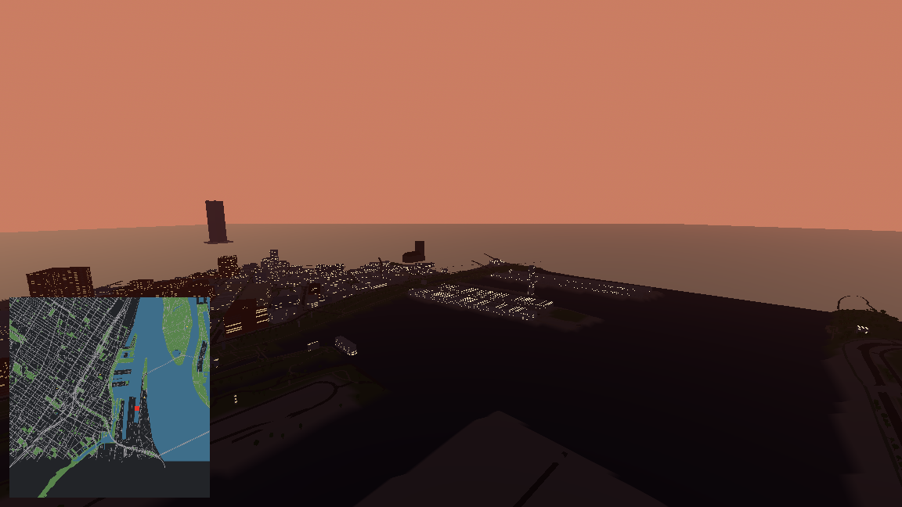 |
| 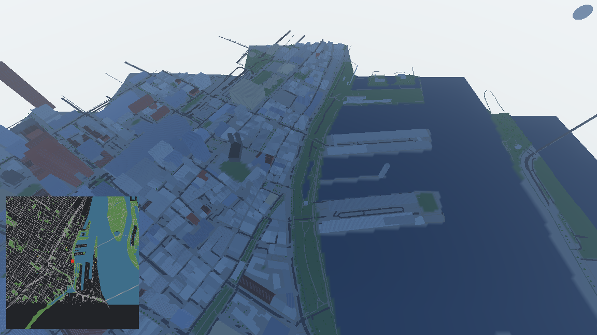 | 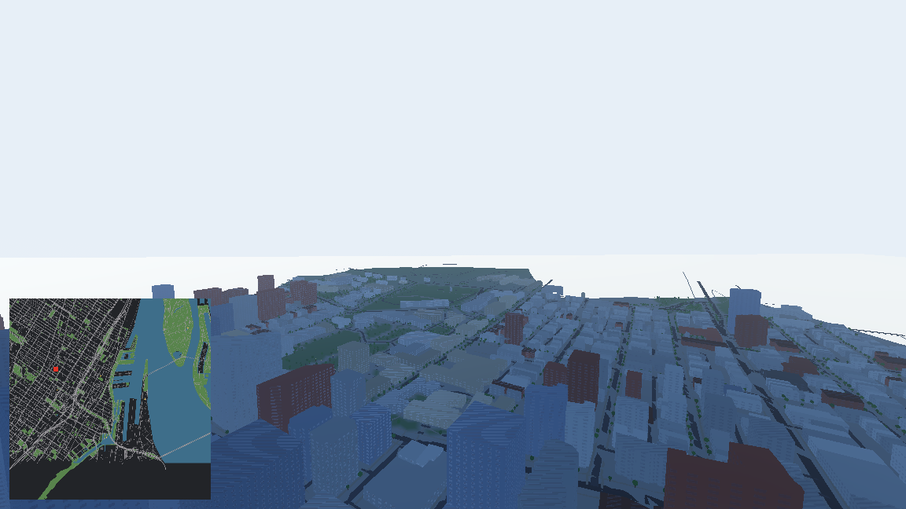 |
| 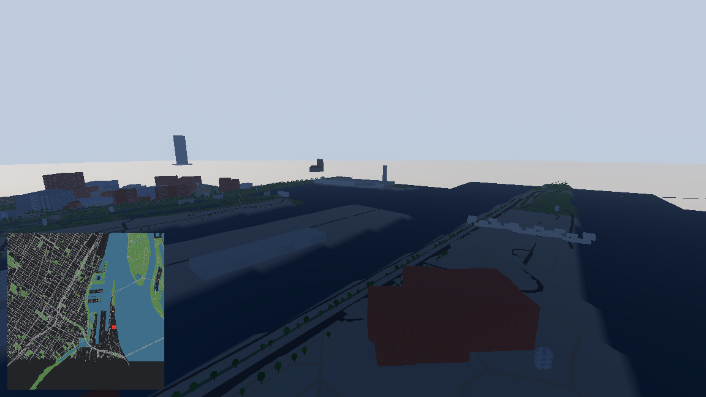 | 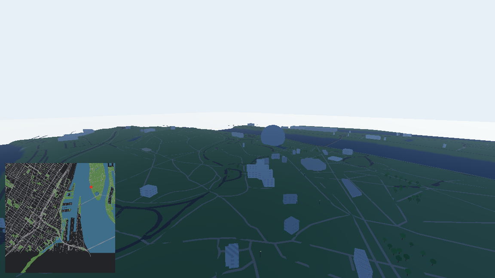 |

## New: *Nuit de livraison* — the first game mode

The slice is now a game. You're an on-foot courier working a 6-minute rainy evening shift in Old Montréal, from blue hour into night.

| | |
|---|---|
| 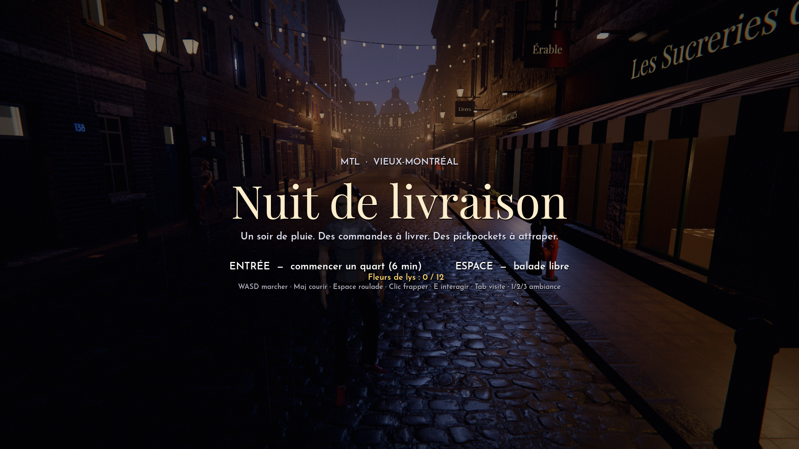 | 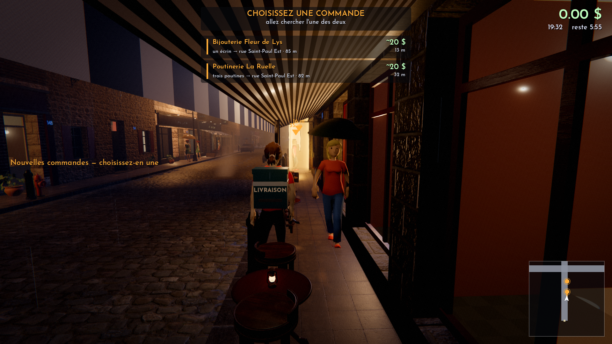 |
| 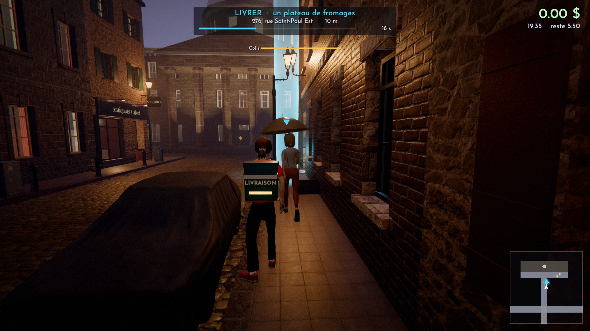 | 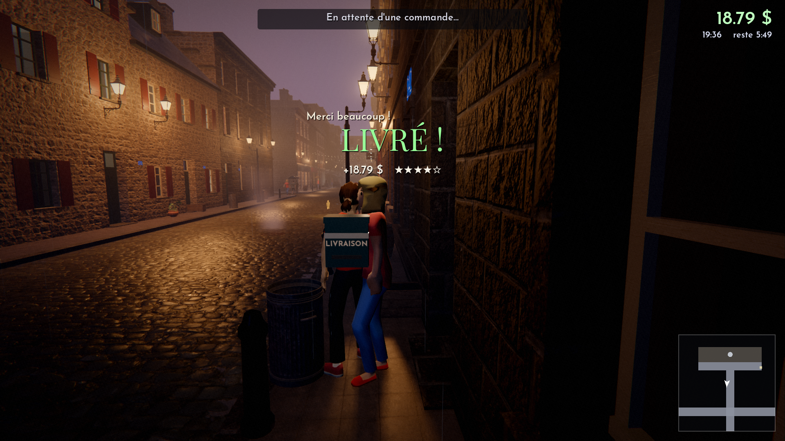 |

- **Choose your job**: two offers light up at once as beams at their shops: amber for regular, rose for express. Each card shows the item, the destination street, the route length and an estimated pay. Run into either beam to take that job; the other one lapses. Pickup and drop-off happen as soon as you arrive (**E** also works).
- **Move like a courier**: you jog by default and sprint with **Shift** on a 5-second stamina bar (empty it and you're winded until it refills to 35 %). **Space** jumps, with coyote time and input buffering. **C**, **Ctrl** or right-click dives. Acceleration is quick, reversals plant and push off, and you lean into turns. Gamepad works too: left stick, RT sprint, A jump, B dive, X shove, Y interact, Start for a shift or pause.
- **Get paid**: base pay grows with the route length along the street graph. Tips scale with time left and bag condition. On-time streaks multiply tips, express orders pay double tips on a tighter clock, and the clock tightens as the shift goes on. The last 8 seconds tick. Each drop-off gets a 1–5 star rating.
- **Weave, don't bump**: sprinting close past people while carrying pays small *Frôlé !* style tips that chain. Bumping them, diving with the bag, hard landings and cars all damage it, and fragile items (wine, vinyl, art) suffer more. Shoving passers-by costs a fine.
- **Traffic**: cars nose through one-way rue Saint-Paul and rue Saint-Vincent and two-way rue de la Commune. They brake for anyone in the lane and honk at a courier blocking them. Step out too late and they clip you. Headlights and brake lamps reflect on the wet cobbles.
- **Au voleur !** Pickpockets strike now and then. They run the street graph away from you in bursts and tire in between. Sprint them down, then dive or shove for a 25 $ reward.
- **Goals**: bronze 175 $, silver 275 $ and gold 400 $ medals, plus your best shift, saved. Twelve gilt fleurs-de-lys are hidden around the quarter.
- **Interface**: HUD with cash, clock, streak, offer cards, an order timer, bag and stamina bars, a centred *LIVRÉ !* stamp, floating world text, a hit flash, edge-of-screen pointers to every target, and a minimap with the walking route and the cars. The title and end-of-shift screens play over the cinematic tour. **Esc** pauses.
- **Sound**: a synthesized late-night jazz loop (Rhodes, upright bass, brushes) under the rain, plus synthesized cues: order ping, cash chime, police whistle, car horn, near-miss whoosh, countdown tick.
- **The courier**: a red jacket and an insulated *LIVRAISON* backpack whose status strip glows while an order is inside. The camera swaps shoulders and pulls in near walls, widens its FOV at a sprint and shakes on impacts.

Run `play_slice.bat` and press **Enter** for a shift or **Space** for free roam.

Gates (headless, `tools/godot/godot_console.exe --headless --fixed-fps 60 --path game --script res://slice/<gate>.gd`):

| Gate | Checks | Pass line |
|---|---|---|
| `game_test.gd` (with `SLICE_SAVE=user://test_save.json`) | street-graph routes, two offers, walk-in pickup, auto delivery, pay and stars, pause, car hit, thief, fleur, end of shift, save | `GAME OK` |
| `move_test.gd` | jog and sprint speeds, stamina drain, winded state and regen, jump apex and air time, dive burst, reversal time, clean stop | `MOVE OK` |
| `traffic_test.gd` | cars move, stop short of a courier in the lane, wait and honk, pull away, clip a late step-out | `TRAFFIC OK` |
| `walk_test.gd` | real-input walk across kerbs and sidewalk ends on all three streets | `WALK OK` |
| `doors_test.gd` | walks up to every one of the 70 delivery doors with real input | `DOORS OK` |
| `bot_test.gd` (with `SLICE_SAVE=user://bot_save.json`) | a bot plays a whole shift on real input; every door it's sent to must be reached (baseline: 11 deliveries, about 326 $) | `BOT OK` |

## New: the Rue Saint-Paul vertical slice

One hand-dressed Old-Montréal street at blue hour, just after rain. It's the new visual bar: content quality first, one location done properly before scaling back up to the whole city.

| | |
|---|---|
| 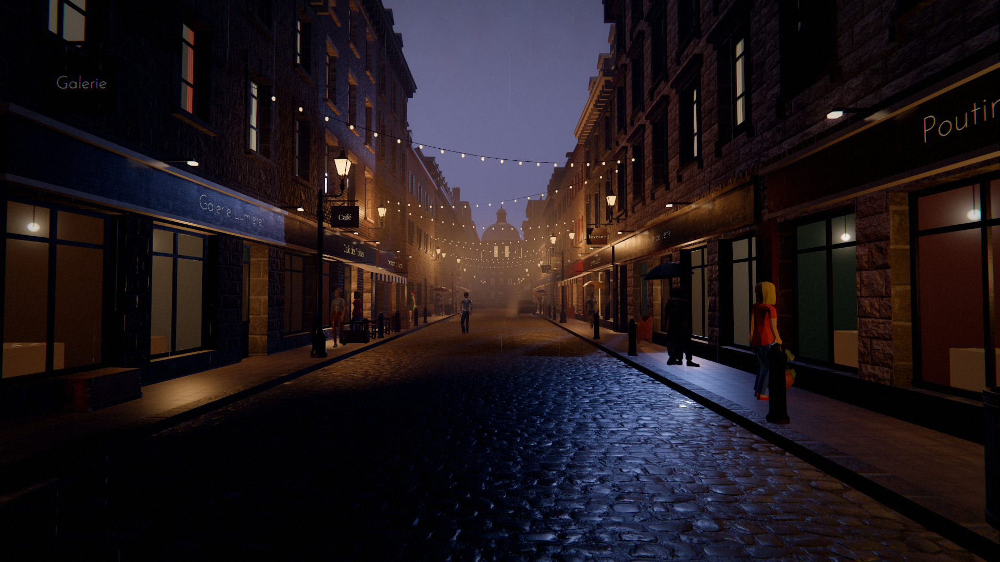 | 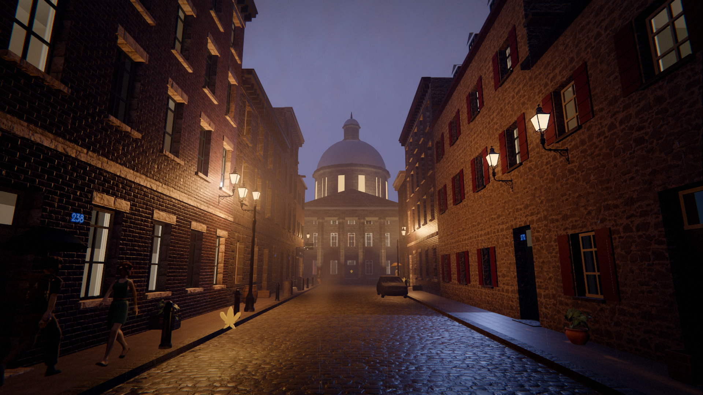 |
| 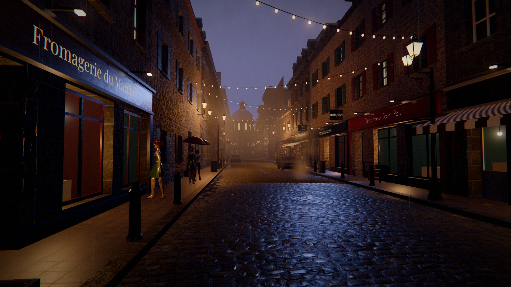 | 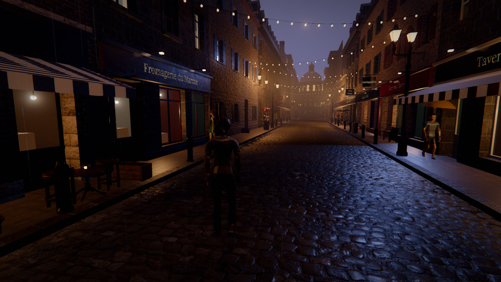 |
| 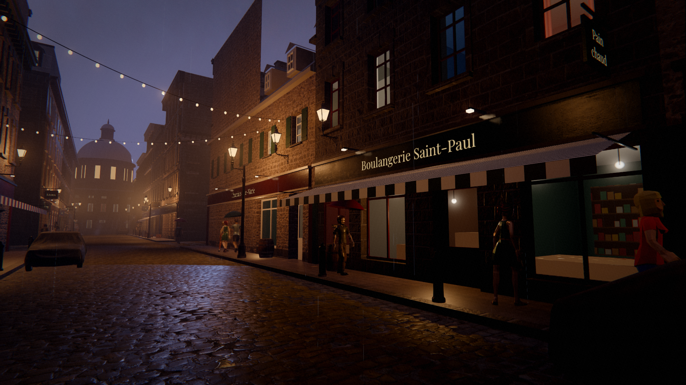 | 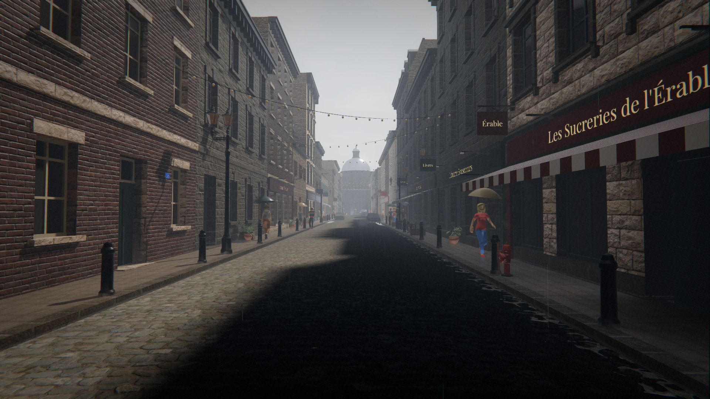 |

- **Procedural facades with real depth**: greystone, red-brick, French-régime (rubble walls, steep roofs, firewalls, shutters) and Victorian styles. Real window openings with stone reveals, casement frames and muntins, cornices with modillions, mansards with dormers, chimneys. Every window shows an interior-mapped room (parallax walls, pendant lamps, curtains, TV flicker), and shops show shelving and display tables.
- **Wet street**: world-space PBR cobbles (Poly Haven CC0) with puddles that pool in the stone gaps and gutters, animated rain ripples, and screen-space reflections of every lamp and shop window.
- **Light**: wall lanterns, cast-iron kerb lamps, café string lights, glowing shopfronts, a floodlit Marché Bonsecours dome closing the vista, volumetric fog, SDFGI, and AgX tonemapping. Three moods: blue hour, night, overcast day.
- **Life**: umbrella-carrying pedestrians, window-shoppers, a third-person player who can walk, run, roll, punch and wave (CC0 Quaternius characters), steaming manholes, cars under tarps, and synthesized rain, drip and footstep audio.
- **~60 fps at 1080p** on an RX 6700S laptop (High preset; F5 cycles Medium/High/Ultra). Only the 5 lamps nearest the camera render shadow maps.

Run it: `.venv/Scripts/python -m pipeline.slice_assets` once (fetches the gitignored CC0 assets, hash-verified), then `play_slice.bat`.
Controls: WASD run · Shift sprint · Space jump · C/RMB dive · LMB shove · Alt walk · E interact · Esc pause · V fly-cam · Tab cinematic tour · F1–F3 mood · R rain · F5 quality · H help.
Screenshots: `tools/godot/godot_console.exe --path game --resolution 1920x1080 --script res://slice/shots.gd`. Fly-through video: `... res://slice/slice.tscn --write-movie out.avi --fixed-fps 30 -- --tour`.

## How it works

Two halves, joined by a data contract:

```
OpenStreetMap ──┐
                ├──►  pipeline/  (Python)  ──►  game/world/  ──►  game/  (Godot 4.5)
HRDEM elevation ┘     offline, deterministic     glTF tiles         runtime
```

- **`pipeline/`** — Python. Downloads downtown Montréal from OpenStreetMap (Overpass) and terrain from Canada's HRDEM elevation data, then converts it into 256 m glTF tiles: extruded buildings colored by type (brick residential, glass towers, greystone churches), roads by class, the St. Lawrence assembled from multipolygon relations, and terrain-draped everything. Deterministic — same input, byte-identical output. `nav.json` carries road/sidewalk polylines with baked heights so traffic and (M10b) pedestrians never raycast.
- **`game/`** — Godot 4.5. Loads the tiles, distance-culls them, and runs the day/night cycle, minimap, and (soon) the player.
- **Hero landmarks** — Place Ville Marie, Notre-Dame Basilica, the Biosphère, Habitat 67, and the Farine Five Roses sign are procedurally modeled low-poly at their true coordinates.

## Roadmap

- [x] **M1–M2** — Gray city: real street grid + extruded buildings, fly-cam
- [x] **M3** — Make it Montréal: palette, river, Mont Royal terrain, landmarks, day/night, minimap
- [x] **M3.5** — WOW pass: emissive windows at night, 16k street trees & lamps from OSM, procedural sky/SSAO/glow/ACES, animated water, roof caps & gables
- [x] **M4** — On foot: third-person character (blocky minifig with a tuque), lazy trimesh collisions, street + district HUD, spawn downtown (F = debug fly-cam)
- [x] **M5** — Behind the wheel: 120 parked cars on real streets, walk up + **E** to drive (arcade physics, chase cam, speedometer)
- [x] **M6a** — Surfaces: real CC0 textures (brick/stone/concrete facades, asphalt, paving), window frames & storefronts, sidewalks with curbs, lane markings
- [x] **M6b** — Light: warm sun & ambient, thinner fog, pooled street lights, car headlights
- [x] **M6c** — Things: Kenney CC0 car models, traffic lights at real signal positions, credits screen (**C**)
- [x] **M7** — Polish: procedural audio (engine/footsteps/ambient — synthesized, license-free), kill-plane respawn, one-way streets get white centerlines, facades anchored to real ground height, car & headlight tuning, landmark collision
- [x] **M8** — Realism Graphics I: procedural sky/water/terrain shaders (fbm clouds & sun disc, analytic waves, grass/dirt/rock blend + dirt paths), CC0 wall/road/sidewalk textures with per-building facade variation, 16,498 OSM trees & 21 benches via a pooled MultiMesh prop renderer, white-car colormap fix
- [x] **M9** — Realism Graphics II: warm sun/shadow/fog grade (shadow reach, contrast/saturation grade, volumetric night fog), crosswalks & manhole decals & ground-floor doors, fake window interiors & camera-near grass, CC0 player model, storefront awnings, lamp-colormap safety net
- [x] **Game** — *Nuit de livraison*: courier shifts (orders, timers, tips, streaks, express), pickpocket chases, hidden fleurs-de-lys, HUD/minimap/pointer, saves; the quarter expanded to three streets
- [x] **Game II** — mechanics rework: courier movement (jog/sprint/stamina, jump, dive, gamepad), two-offer choice with walk-in pickup, near-miss tips, live traffic, medals, pause, attract-mode title, music; shift bot gate
- [x] **Slice** — Rue Saint-Paul vertical slice: procedural Old-Montréal facades with interior-mapped windows, rain-wet cobbles, lamps, pedestrians, a third-person player, ~60 fps (new visual bar; see above)
- [x] **M10a** — Traffic: pipeline exports a road + sidewalk nav graph (`nav.json`, tiles byte-identical); 40 pooled cars drive real lanes on the right, queue at real signal positions, yield at junctions, brake for you, and collide with your car; pooled headlights at night

## Run it

1. `py -m venv .venv && .venv/Scripts/pip install -r requirements.txt`
2. [Godot 4.5-stable](https://godotengine.org/download/archive/) portable → `tools/godot/`
3. Generate the city (or use the committed tiles in `game/world/`): `.venv/Scripts/python -m pipeline.build`
4. Open `game/` in Godot and run `scenes/main.tscn` — WASD + mouse to walk, **E** near a parked car to drive, **F** for the debug fly-cam, hold **T** to fast-forward time

Tests: `.venv/Scripts/python -m pytest pipeline -q` and `tools/godot/godot_console.exe --headless --path game --script res://tests/smoke_test.gd`

## Data & licenses

Full attributions: [CREDITS.md](CREDITS.md) (also in-game — press **C**).

- Map data © [OpenStreetMap](https://www.openstreetmap.org/copyright) contributors (ODbL)
- Terrain: [HRDEM](https://open.canada.ca/data/en/dataset/957782bf-847c-4644-a757-e383c0057995) — Natural Resources Canada (Open Government Licence – Canada)
- Engine: [Godot](https://godotengine.org/) (MIT)

*Poutine not included.*
